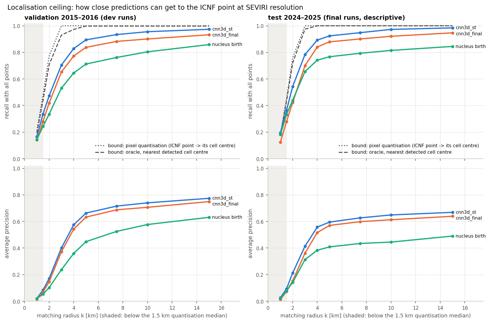
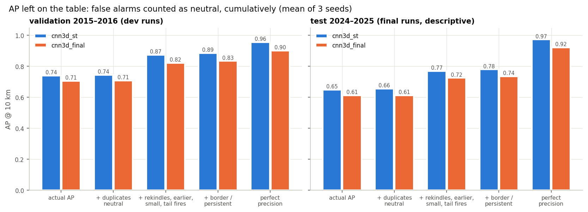
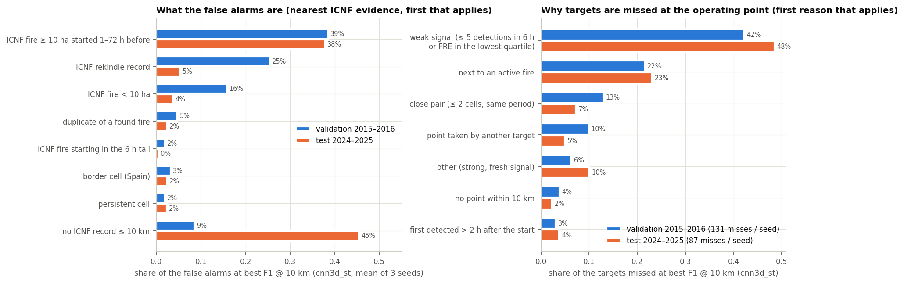
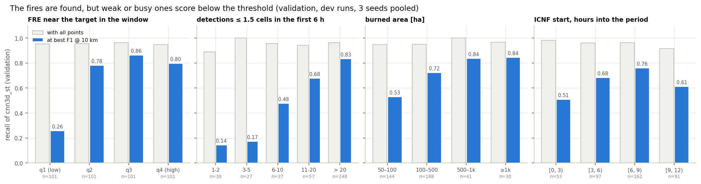
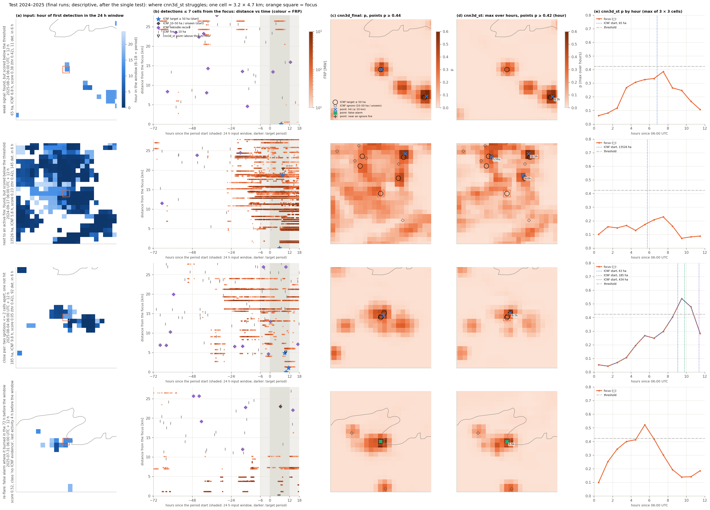
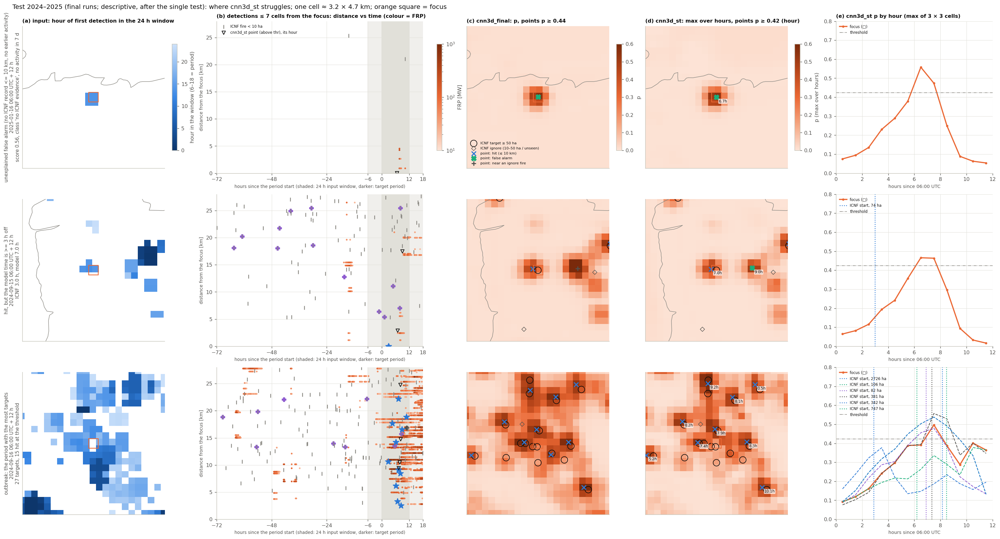

# Space-time ignition model: evaluation, ceilings and next steps

State 2026-11-19. This document evaluates the newest runs (`cnn3d_st`, `cnn3d_final`, `conv_final`), asks how far ignition mapping can go at SEVIRI resolution, shows where and why the space-time model fails, and ranks the improvements worth making. The methods log with every number is `notes.md` §9.21; this file is the narrative for the supervisor meeting.

**Where the numbers come from.** The headline test numbers are the single test of `notes.md` §9.20 (2024–2025, run once). Everything new here was computed without training (`src/error_analysis.py`, `src/decode_study.py`, `src/plot_failure_examples.py`, `src/plot_ceilings.py`). All conclusions and improvement choices rest on validation 2015–2016 with the runs trained without those years (`ablations_all/*_all_s0-2`). The test years were used only descriptively, in the same way as the example figures of §6.18, and give the same picture. External facts carry a source in §8; *[abstract]* marks sources seen only as an abstract or search summary.

## 1. Bottom line

- **`cnn3d_st` is the best method on the held-out years 2024–2025**: AP 0.595 / 0.649 at 5 / 10 km, against 0.570 / 0.613 for the same 2D model trained on the same data and 0.409 / 0.445 for the nucleus-birth rule. The gain over the 2D model (+0.025 / +0.036) has a bootstrap interval above zero at 10 km and touching zero at 5 km. It sits where the design aimed: close pairs (recall 0.51 → 0.77) and new fires next to active ones (0.70 → 0.88). The model also gives the ignition time, with a median error of 0.33 h.
- **The model already finds nearly every target.** Some point lies within 10 km of 97 % of the test targets (95 % on validation). That is the ceiling of the target definition itself (98.7 % of the test targets have their own peak in the space-time target). What it does not do well is rank: at its best-F1 threshold it hits 63 % of the test targets at 68 % precision.
- **Most misses are fires it found but scored too low** (86 % on validation, 93 % on test). They are mostly weak fires (few detections, low fire radiative energy, 50–100 ha) and new fires inside burning areas.
- **About 90 % of the false alarms at the operating point are real fire activity that the label does not count**: re-flares of fires that burned in the previous 72 h, recorded rekindles, fires below 10 ha. If those counted as neutral, AP at 10 km would be 0.87 instead of 0.74 on validation (0.77 instead of 0.65 on test). The precision problem is mostly a label-definition problem.
- **Localisation is at the pixel floor.** The median error of the hits is 1.8–2.0 km (5 km matching). Pure pixel quantisation gives 1.5–1.6 km, and an oracle that always picks the detected cell nearest the ICNF point gives 1.6 km. The space-time model does not localise better than the 2D model; its gain is in finding and separating fires.
- **What SEVIRI sees is itself a ceiling.** It detects 81–83 % of the fires ≥ 50 ha in their first 6 h (89–91 % of the burned area). Against all fires ≥ 50 ha, `cnn3d_st` places a point near 86 %, covering 94–96 % of the burned area.
- **How far it can go.** At SEVIRI resolution the remaining gains are in ranking, via the label definition, reactivation and size, and in decoding (a seed ensemble with sub-pixel decoding adds +0.01 AP and −0.19 km on validation), not in localisation. A 1 km sensor (MTG FCI, since 2025) would cut the quantisation floor to 0.5 km and give 89 % instead of 59 % of close pairs their own peak in a single map. Below about 1 km the accuracy of the ICNF points, not the sensor, becomes the limit of what can be measured.

## 2. Results of the newest runs

### 2.1 Test 2024–2025 (single test, `notes.md` §9.20)

232 targets (111 in 2024, 121 in 2025); 3 seeds, mean ± std. The 2016 models were trained on 2004–2016, the 2023 models on 2004–2023.

| Method | Trained on | AP @ 5 km | AP @ 10 km | Recall @ 10 km, all points | P / R at best F1 @ 10 km | False alarms / day | Median error of hits @ 5 km |
|---|---|---|---|---|---|---|---|
| nucleus-birth rule | – | 0.409 | 0.445 | 0.815 | 0.53 / 0.56 | 0.16 | 1.68 km |
| `cnn3d_final` | 2004–2016 | 0.557 ± 0.012 | 0.603 ± 0.008 | 0.927 | 0.59 / 0.64 | 0.14 | 1.95 km |
| `conv_final` (ConvLSTM) | 2004–2016 | 0.578 ± 0.021 | 0.619 ± 0.029 | 0.917 | 0.71 / 0.54 | 0.07 | 1.96 km |
| `cnn3d_final` | 2004–2023 | 0.570 ± 0.019 | 0.613 ± 0.012 | 0.921 | 0.63 / 0.68 | 0.13 | 2.03 km |
| **`cnn3d_st`** | 2004–2023 | **0.595 ± 0.018** | **0.649 ± 0.017** | **0.973** | 0.68 / 0.63 | 0.10 | **1.84 km** |

| Difference of seed means (95 % period bootstrap) | Δ AP @ 5 km | Δ AP @ 10 km |
|---|---|---|
| `cnn3d_st` − `cnn3d_final`, both 2004–2023 | +0.025 [−0.004, +0.054] | **+0.036 [+0.004, +0.066]** |
| `cnn3d_st` 2023 − `cnn3d_final` 2016 | **+0.038 [+0.009, +0.066]** | **+0.046 [+0.017, +0.075]** |
| `cnn3d_final` 2023 − 2016 (more years) | +0.013 [−0.011, +0.038] | +0.010 [−0.012, +0.035] |
| `conv_final` 2016 − `cnn3d_final` 2016 | +0.021 [−0.018, +0.055] | +0.016 [−0.011, +0.044] |

| Recall @ 10 km, all points | targets | `cnn3d_final` 2023 | `cnn3d_st` |
|---|---|---|---|
| in a close pair (≤ 2 cells, same period) | 17 | 0.51 | **0.77** |
| already burning (detection ≤ 1.5 cells in the 6 h before) | 43 | 0.70 | **0.88** |
| not isolated / isolated | 142 / 90 | 0.88 / 0.99 | **0.96** / 1.00 |
| ≥ 1,000 ha | 50 | 0.89 | **0.99** |
| AP @ 10 km 2024 / 2025 | | 0.718 / 0.574 | 0.742 / 0.622 |

### 2.2 Validation 2015–2016 (runs trained without these years)

| Configuration (3 seeds) | AP @ 5 / 10 km | Recall in pair @ 10 | Already burning @ 10 |
|---|---|---|---|
| `cnn3d_final`, all years except 2015–2016 | 0.633 / 0.706 | 0.46 | 0.70 |
| **`cnn3d_st`**, same years | **0.663 / 0.740** | **0.74** | **0.86** |
| difference (bootstrap) | +0.030 [+0.006, +0.053] / +0.034 [+0.016, +0.051] | | |

More training years do not change the 2D model (−0.002 / +0.002). For `cnn3d_st` the data effect (+0.017 / +0.009) rests on a single 2004–2014 seed and is not established. The final models fit their own training years only moderately better (+0.04 to +0.06 AP, §9.19), so they do not memorise. The 2D model's in-pair recall stays at 0.46 even on its own training years: one map per 12 h cannot represent two ignitions in neighbouring cells.

### 2.3 Ignition time (test, hits @ 10 km)

| Method, time | median \|Δt\| | ≤ 1 h | AP with τ = 1 / 2 h | isolated | in pair | already burning |
|---|---|---|---|---|---|---|
| `cnn3d_final` + first-detection rule | 0.30 h | 72 % | 0.415 / 0.493 | 0.27 h | 0.22 h | 3.01 h |
| `cnn3d_st`, own time | 0.46 h | 72 % | 0.477 / 0.575 | 0.37 h | 1.24 h | **1.46 h** |
| **`cnn3d_st`, combined** (§9.18) | **0.33 h** | 72 % | **0.489 / 0.582** | 0.27 h | 1.23 h | 1.69 h |

When place and time both have to be right, `cnn3d_st` leads by +0.07 to +0.09 AP. That is more than twice its place-only gain, because it finds more targets and times fires in active areas better.

### 2.4 Reading of the results

1. The space-time target is the one design change since the geo-referencing fix that moves AP well beyond the seed spread, on validation and on unseen years alike. Its gain comes from the busy cases.
2. At one operating point the two models tie (F1 0.65 at 10 km). `cnn3d_st` is more precise there (0.68 vs 0.63) and `cnn3d_final` has more recall. The AP gain lies in the ranking at high recall. Report AP and the operating point together.
3. The ConvLSTM is level with the 3D CNN. It is the most conservative model (0.07 false alarms per day, recall 0.54 at its threshold).
4. All methods, the rule included, score lower in 2024–2025 than on validation. 2025 is the hardest year (megafires, extreme weather), so the drop reflects the years, not overfitting.

## 3. Ceilings: how far the task can go at SEVIRI resolution

### 3.1 Localisation

| Median distance to the ICNF point | validation | test |
|---|---|---|
| pixel quantisation: ICNF point → centre of its cell (3.2 × 4.7 km over Portugal) | 1.52 km | 1.57 km |
| oracle: the detected cell nearest the ICNF point | 1.61 km | 1.61 km |
| FRP-weighted centroid of the first detection slot | 2.46 km | 2.02 km |
| nucleus-birth rule, hits @ 5 km | 2.19 km | 1.68 km |
| `cnn3d_final` hits @ 5 km | 2.00 km | 2.04 km |
| `cnn3d_st` hits @ 5 km | 2.02 km | 1.83 km |
| `cnn3d_st`, 3-seed ensemble + log-parabola decoding (validation only, §6) | 1.82 km | – |

- The model beats every hand-made estimate from the detections and sits 0.2–0.4 km above the oracle. The oracle is not attainable, because it uses the label to choose the cell. The realistic headroom at SEVIRI resolution is a few hundred metres.
- Within 2 km no method can do much: even pure quantisation puts only 77 % of the ICNF points within 2 km of their cell centre. AP at 5 km is the strict but meaningful metric.
- **How accurate are the labels?** For fresh, isolated fires whose first detection is a single cell (294 targets, all non-test years), the ICNF point lies inside that cell for only 53 %. Per axis, the offset spread is 1.45 km east–west and 1.99 km north–south, against 0.91 / 1.34 km for pure quantisation. The remaining spread bounds the ICNF position error from above at ≤ 1.1 km (E–W) and ≤ 1.5 km (N–S). The bound also contains detections in neighbouring cells: SEVIRI's infrared field of view is about 4.8 km for a 3 km sampling distance, with a detector point-spread function 6.8 km wide at the sub-satellite point (Schmetz et al. 2002). A systematic +0.74 km southward offset remains, the residual of §6.12 (terrain parallax hypothesis).

### 3.2 What the target can represent

Targets with their own peak in the target tensor itself (labels only, no model): test 97.0 % in 2D and 98.7 % in space–time; in close pairs 58.8 % → 82.4 %. Validation: 94.5 % → 97.3 %; in pairs 57.7 % → 78.8 %. **The test recall with all points (97.3 %) has reached this ceiling.** Pairs that start less than about 1.5 h apart and within one cell stay merged at SEVIRI resolution, whatever the model.

### 3.3 Ranking and the label definition

| AP @ 10 km, `cnn3d_st` | validation | test |
|---|---|---|
| actual | 0.740 | 0.649 |
| + duplicates of found fires neutral | 0.745 | 0.655 |
| + re-flares, rekindle records, fires < 10 ha, fires starting in the tail neutral | **0.874** | **0.769** |
| + border and persistent cells neutral | 0.885 | 0.779 |
| perfect precision (= recall with all points) | 0.955 | 0.973 |

The target is "a new ICNF record of a fire that reaches ≥ 50 ha". SEVIRI sees fire activity, and the model scores fire activity well (AUC 0.94 between its hits and its false alarms, against 0.73–0.78 for the raw FRE). The gap to the ceiling is mostly activity that is real but not a new ≥ 50 ha record. Its two parts:

- **New or old?** A fire that re-flares on its second or third day looks like a new ignition inside a 24 h window. ICNF sometimes records such a re-flare as a new fire (a rekindle record) and often does not. The information exists in the satellite history, but in a cross-year re-scoring test the history before the window did not improve AP (cnn3d_st −0.002 / −0.005; cnn3d_final +0.007 / +0.005), because many true targets start where something burned before. A model can learn this only with a label that separates re-flares from new ignitions.
- **≥ 50 ha or not?** The final burned area is weakly determined by the first 6–18 h of fire radiative power. Per fire, FRE and burned area correlate at only r = 0.58 (log–log, §2.2), and the model's score of its hits follows FRE (Spearman 0.52) more than the burned area (0.34). Hits of 50–100 ha are found as often as large fires but scored lower.

### 3.4 What SEVIRI sees

| All ICNF fires ≥ 50 ha of the split | validation | test |
|---|---|---|
| fires ≥ 50 ha / seen by SEVIRI in their first 6 h | 497 / 81 % | 280 / 83 % |
| burned area of the seen fires | 89 % | 91 % |
| `cnn3d_st` point ≤ 10 km: all fires ≥ 50 ha (share of their burned area) | 86 % (94 %) | 86 % (96 %) |
| `cnn3d_st` at the operating point: all fires ≥ 50 ha (share of burned area) | 61 % (78 %) | 57 % (64 %) |

The metrics in §2 are conditional on SEVIRI seeing the fire. The detection limit is physical: SEVIRI's 3 km pixels miss many fires below roughly 40–50 MW (LSA SAF ATBD 2025; Roberts & Wooster 2008), with high omission over Europe compared with MODIS (Roberts et al. 2015). The model still has a point within 10 km of 20–29 % of the "unseen" fires; only 9–13 of them have a detection within 5 km later in the window, so most of these points belong to neighbouring fires.

### 3.5 Time

For isolated fires, the ICNF alert time and the first SEVIRI detection agree to about a quarter of an hour (§6.19). The combined time reaches that level (0.27 h on test), so it is at the floor there. The error left is in busy places: 1.2 h in close pairs and 1.5–1.7 h next to active fires, where the first detection belongs to the earlier fire. Under cloud SEVIRI sees fires about 2 h late, and the model's time is then just as late (§9.13).

### 3.6 How far it can go

| Quantity | Now (`cnn3d_st`, test / val) | Ceiling at SEVIRI resolution | What sets it | What would move it |
|---|---|---|---|---|
| localisation, median error of hits @ 5 km | 1.83 / 2.02 km (1.82 km val with ensemble + log-parabola) | ≈ 1.5–1.6 km | 3 km sampling, 4.8 km field of view, ICNF point accuracy | a 1 km sensor (FCI); better labels |
| targets with a point ≤ 10 km | 0.973 / 0.955 | 0.987 / 0.973 (the target tensors) | pairs < 1.5 h and < 1 cell apart | 1 km pixels: own peak for 89 % instead of 59 % of pairs |
| AP @ 10 km | 0.649 / 0.740 | 0.77 / 0.87 if label-definition false alarms were neutral; 0.97 / 0.96 with perfect ranking | the label (new record ≥ 50 ha) vs what the sensor sees (re-flares, rekindles, small fires); size from early FRP | reactivation-aware and size-aware targets; a second protocol |
| fires ≥ 50 ha covered | 86 % (96 % of the burned area) | 81–83 % seen in the first 6 h | detection limit ≈ 40–50 MW, cloud, smoke, water-edge mask | FCI's lower detection limit; polar sensors |
| ignition time, isolated fires | 0.27 h | ≈ 0.25 h | ICNF alert vs first scan | 10 min scans (FCI) |
| ignition time, next to active fires | 1.5–1.7 h | unknown | the first detection belongs to the earlier fire | finer pixels, a time head |

**Projection to 1 km pixels** (labels only, all non-test years, a 3× finer grid standing for the 1 km sampling of the MTG FCI 3.8 µm channel): close-pair targets with their own peak in one 2D map rise from 59 % to 89 %, and the quantisation floor falls from 1.51 to 0.50 km. The LSA SAF MTG FRP product (LSA-509: 1 km, every 10 min, back-processed to 2025-01-01, demonstration status) makes this testable. The catch: if the ICNF position error were as large as the bound in §3.1, even a perfect estimate would remain a median 1.5 km from the ICNF point (0.8 km at half the bound). Beyond SEVIRI, an independent reference (VIIRS 375 m) is needed to show sub-kilometre accuracy at all.

## 4. Where and why the model fails

### 4.1 Misses and false alarms

Misses at the operating point, mean per seed (validation / test): found but scored below the threshold 113 / 80, point taken by another target 13 / 4, no point within 10 km 5 / 2. By primary reason (validation / test): weak signal 42 / 48 %, next to an active fire 22 / 23 %, close pair 13 / 7 %, taken by another target 10 / 5 %, strong fresh signal scored low 6 / 10 %, no point 4 / 2 %, first detected more than 2 h after the start 3 / 4 %.

- **Weak fires.** With 1–5 detections in the first 6 h, recall at the threshold is 0.14–0.17. With more than 20 detections it is 0.83, and with all points it is about 0.95 in every bin. 50–100 ha fires reach 0.53 at the threshold, fires ≥ 500 ha 0.84.
- **Busy places.** Targets "seen" only through detections of an older nucleus (21 % of the validation targets) reach 0.44 at the threshold, against 0.74 for the others.
- **Observation time and context.** Fires starting in the last 3 h of the period (6–9 h of input left after the start) reach 0.61, against 0.76 for hours 6–9. Starts in the first 3 h reach 0.51: they are mostly evening starts (70 % fall in 18–06 UTC periods) and, like the late ones, twice as often next to fire that was already burning (30 % against 15 % for hours 6–9).
- **False alarms.** At the threshold, 55 % (validation) and 77 % (test) of them lie where SEVIRI saw burning in the 72 h before the input window, against 23–28 % of the hits. By the nearest ICNF record: an earlier fire ≥ 10 ha 39 / 38 %, a rekindle record 25 / 5 %, a fire < 10 ha 16 / 4 %, nothing 9 / 45 %. The split between the classes follows how much ICNF recorded: 2015–2016 have 16–20 thousand records and 1.4–1.5 thousand rekindles per year, 2024–2025 only 6–8 thousand and 0.4–0.7 thousand. With satellite and ICNF evidence together, about 90 % of the false alarms are explained in both periods.

### 4.2 Example periods

Cases are chosen by fixed rules (random with seed 0 inside each type, no hand-picking). Columns: (a) input, hour of first detection; (b) every detection within 7 cells of the focus, distance against time, from 72 h before the period to the end of the window, with ICNF records marked; (c) `cnn3d_final`; (d) `cnn3d_st` with the hour of each point; (e) `cnn3d_st` probability by hour at the focus. Test 2024–2025 (final models, descriptive):

| Case | Period (UTC, + 12 h) | What the figure shows |
|---|---|---|
| weak signal | 2025-08-24 06 | a 65 ha fire with few detections; the hourly curve peaks at the right hour (score 0.38) but stays under the threshold (0.42) |
| next to an active fire | 2024-09-17 06 | a 13,526 ha target that starts inside the burning complex of 15–17 September 2024; every cell around has burned for a day, score 0.23 |
| close pair | 2025-08-04 06 | three targets (63, 185, 434 ha) within 1–2 cells and 2.3 h; one peak at 9.7 h serves the first two |
| re-flare | 2025-07-31 06 | the place burned on each of the three days before the window; no ICNF record; flagged as a new ignition (0.52) |
| unexplained | 2025-01-16 06 | a short winter burn with no ICNF record within 10 km (a probable unrecorded agricultural or pastoral burn) |
| time off | 2024-09-15 06 | hit in place; SEVIRI first sees the fire about 4 h after the ICNF alert, and the model time follows the detection |
| outbreak | 2024-09-16 06 | 27 targets, 15 hit at the threshold; the misses are merged peaks and weak fires between larger ones |

The same rules on validation with the dev runs (`figures/error_analysis/val_failure_examples_{1,2}.png`) add a **time duplicate** (2016-08-23): the hourly curve at an isolated fire has a secondary bump 3 h before the hit with no detection behind it, which the 3D peak search turns into a second point. One figure per case for slides: `figures/error_analysis/cases/`.

### 4.3 Why the model fails

1. **The input cannot tell old from new.** The 24 h window, with 6 h of history, hides activity from the previous days. A diurnal re-flare looks like a fresh ignition, and ICNF records only some of them.
2. **The size of a fire is not in its first hours.** The label asks for ≥ 50 ha, but the evidence is a few 3–5 km hotspots and their FRP. Weak 50–100 ha fires look like the many small fires that never reach the label.
3. **Resolution.** Ignitions within one cell and 1–1.5 h cannot be separated. The first detection of a fire inside a burning area belongs to the older fire, so neither place nor time is observable.
4. **The sensor misses.** Cloud, smoke and the detection limit delay or hide the first detection; the model's time then waits for it.
5. **Temporal decoding** (hypothesis). The encoder works at 4 h steps before the decoder brings the time axis back to hours. Secondary bumps in the hourly curve become duplicate points. They cost about 5 % of the false alarms on validation; a wider duplicate window would remove them, but it merges true pairs again (§6).

## 5. The concept: what holds and what limits it

**What holds.**
- Heatmaps over all ignitions of a period, without hand-made hotspot assignment, beat the rule everywhere, most where the rule fails (busy days, large fires).
- The space-time target fixes the 2D representation limit for most close pairs and adds the ignition time at no cost in place accuracy.
- The models are small (45k–162k parameters) and stable across seeds, hardware (MPS and CUDA) and the change of data source (extract → LSA SAF archive).
- The protocol is sound: chronological split, locked test used once, seeds, period bootstrap, rule-based time baselines, fixed decisions before the test.

**What limits it.**
- **The label definition** (a new ICNF record ≥ 50 ha, "seen" within 6 h) mixes detection with a prediction of final size, and treats re-flares as background unless ICNF happened to record them. It sets the precision ceiling (§3.3).
- **The window** has no memory beyond 6 h, but a memory alone does not help without a label that distinguishes re-flares.
- **Time resolution**: hourly bins and 4 h encoder steps. The model's own time on isolated fires (0.37 h) is worse than the first-detection rule (0.25 h); the combined time fixes this after the fact.
- **The decoding** by peaks merges close ignitions and creates duplicates; no learned suppression.
- **Scores are not probabilities** (the best-F1 thresholds are 0.37–0.50 and differ by model and split). Calibrate before showing probabilities to users.
- **Statistical power.** 232 test targets give AP intervals of about ±0.03; subgroups such as pairs (17) and rekindles (15) are tiny. The test has now been used once and looked at in detail.

## 6. Improvements, ranked by evidence and cost

| # | Change | Failure it targets | Evidence here | Expected effect | Cost | Source of the idea |
|---|---|---|---|---|---|---|
| 1 | 3-seed ensemble + log-parabola sub-pixel decoding | localisation, ranking noise | validation: +0.011 / +0.010 AP, median error 2.01 → 1.82 km | measured; fix it before the next test | none (3× inference) | Zhang et al. 2020 (DARK); `model_review.md` §3.1 |
| 2 | Report a reactivation-neutral protocol next to the primary one (rekindles and places active in the 72 h before) | label-definition false alarms | 90 % of the false alarms are real activity; AP 0.74 → 0.87 if neutral | describes the ceiling honestly; no model change | hours | ICNF SGIF rekindle flag (§8.4) |
| 3 | Size-aware targets: second channel for seen 10–50 ha fires and a log-area output per peak; rank by p × P(area ≥ 50 ha) | weak-signal misses, small-fire false alarms | weak signal is 42–48 % of the misses; 50–100 ha recall 0.53 at the threshold | +1–3 AP points (estimate); size becomes an output (objective i/v) | 1–2 days | Zhou et al. 2019 (CenterNet multi-head outputs); `model_review.md` §4.2 |
| 4 | Reactivation as its own output, trained on SGIF rekindle records and on satellite history channels (hours since last detection, FRE of the last 24 h / 72 h / 7 d) | re-flare false alarms | 55–77 % of the false alarms burned in the 72 h before; a post-hoc feature alone gave no gain | uncertain; the main open question of the precision ceiling | 2–3 days | Che et al. 2018 (time since last observation, GRU-D); `notes.md` §6.6 option 1 |
| 5 | Keep full time resolution in the decoder (no stride in time, dilated temporal convolutions) and add a sub-hour start offset per peak | time on isolated fires (0.37 vs 0.25 h), duplicate peaks | time-duplicate example; model time worse than the rule on fresh fires | combined time without the rule; fewer duplicates | 1–2 days | Zhang, Wu & Li 2022 (ActionFormer: per-moment classification + boundary regression); CenterNet offset head; `notes.md` §9.6 step 3 |
| 6 | Soft suppression of duplicates (decay the score of a weaker peak close in space and time instead of dropping it) | duplicates without merging pairs | a hard ±2 h window cost in-pair recall (0.74 → 0.68) | small; decode-only test | hours | Bodla et al. 2017 (Soft-NMS) |
| 7 | Terrain-parallax correction of the labels with a DEM and the product's viewing angle | residual +0.74 km south offset, which the flip augmentation keeps the model from learning | §3.1; larger in mountain districts (`model_review.md` §6.1); without flips the median error fell 2.08 → 1.83 km (§6.13) | −0.1 to −0.3 km median error (estimate) | 1 day | Liu et al. 2024 (GOFER corrects GOES fire pixels for terrain parallax) |
| 8 | Measure the ICNF position error with VIIRS 375 m first detections (2012+) | the unknown label floor | §3.1 bounds it only from above | turns the bound into a number; needed for any sub-km claim | 1–2 days (FIRMS download) | Schroeder et al. 2014 |
| 9 | Point-set prediction with one-to-one matching for dense outbreaks | close pairs, merged peaks | 7–13 % of the misses; pairs < 1.5 h stay merged | moderate on busy days | 3–5 days | Song et al. 2021 (P2PNet) |
| 10 | Model 2 of the proposal as a small U-TAE (temporal attention per pixel) | interpretability; long windows for reconstruction | architecture variants were all within ±0.03 AP | parity in AP; attention as an explanation | 3–4 days | Sainte Fare Garnot & Landrieu 2021 |
| 11 | Erase augmentation (drop detections in space–time blocks) | cloud and smoke gaps | time error +1.5 h under cloud (§9.13) | robustness, not AP | hours | Pinto et al. 2020 (BA-Net) |
| 12 | Uncertainty-aware targets (predicted spread per peak, Laplace likelihood) | noisy labels, calibration | ≤ 1.1–1.5 km label spread; uncalibrated scores | better-calibrated scores and per-fire uncertainty | 1–2 days | Robinson et al. 2019 (Laplace landmark localisation); Guo et al. 2017 (calibration) |
| 13 | Self-supervised pre-training on the unlabelled detections or SEVIRI radiances | label scarcity | data effect small for the 2D model, open for `cnn3d_st` | uncertain at this label budget | 1 week+ | Girtsou et al. 2026 (HighFM, SEVIRI masked autoencoder); Tseng et al. 2023 (Presto) |
| 14 | MTG FCI 1 km / 10 min as input (2025+) | the pixel floor, close pairs, small fires | projection: pairs 59 → 89 %, quantisation 1.5 → 0.5 km | large, but only one fire season of data and a new grid | weeks | LSA SAF MTG FRP (LSA-509); Paugam et al. 2026 (fire event tracking on FCI) |
| 15 | Post-fire reconstruction with burned-area perimeters and polar detections (arrival-time maps; the ignition as their earliest point) | re-flare vs new fire, size, location | the reconstruction use case is not limited to a 6 h tail | a second, offline product | weeks | Farguell et al. 2021; Shaddy et al. (cWGAN from VIIRS + GOES ignition times) *[abstract]*; McCarthy et al. 2021 |

**Evaluation changes that go with them.** (a) Leave-years-out cross-validation for every change from this list (Roberts et al. 2017), because 2024–2025 is no longer a blind test after this analysis. (b) Report the end-to-end coverage of all fires ≥ 50 ha and of their burned area next to AP (§3.4), since that is what an annual ignition inventory needs. (c) Report AP and the operating point together (§2.4).

**What not to do now.** Bigger or deeper networks (all variants within ±0.03 AP), 15-min steps (no gain at 4× cost, §6.9), wind and cloud channels (no-go tests, §6.20 and §9.13), a wider duplicate window (§6), noisy-OR or 2D-head scores (−0.004 to −0.012 AP).

## 7. Notes on method and caveats

- Validation numbers come from runs that never saw 2015–2016. Test numbers in §3–4 are descriptive. No choice was made on them, and the decode study used validation only. Any of the improvements above has to be confirmed on new folds or new years.
- "Neutral" ceilings (§3.3) assume that a false alarm near an ICNF record or a recent detection is a correct observation of real fire. Some of those may still be wrong predictions near real fires, so the ceilings are upper bounds.
- The false-alarm classes use the ICNF ignition points. For multi-day megafires the front can be tens of kilometres from the ignition point, which is why the satellite history (72 h) is reported alongside.
- The label-noise bound (§3.1) mixes three effects (label position, neighbour-cell detection, spread before the first scan). It is an upper bound, not an estimate.
- Shares of false-alarm classes depend on how densely ICNF records small fires and rekindles, which changed between 2015–2016 and 2024–2025.
- Reproduce: `notes.md` §0, steps 35–37.

## 8. Sources

- Schmetz, J. et al. (2002). An introduction to Meteosat Second Generation (MSG). *Bull. Amer. Meteor. Soc.* 83(7), 977 ff. — 3 km sampling, ~4.8 km IR field of view, detector PSF 6.8 km, 15 min repeat. https://www-cdn.eumetsat.int/files/2020-04/pdf_sci_bams0702_intro-msg.pdf (read, pp. 977–979)
- Wooster, M. J., Xu, W., He, J. (2025). ATBD for the MTG FRP-PIXEL product (LSA-509), SAF/LAND/KCL/ATBD_FRP_MTG v1.1, §1 — SEVIRI undercounts fires below ≈ 40 MW against MODIS; FCI 1 km at 3.8 µm every 10 min. Local copy `docs/lsasaf/` (read)
- LSA SAF (2025-10-01). Release of the MTG Fire Radiative Power product as demonstration — 1 km, 10 min, back-processed since 2025-01-01. https://lsa-saf.eumetsat.int/en/news/news/2025/10/01/release-of-mtg-fire-radiative-power-product-as-demonstration/ *[abstract]*
- Roberts, G. J., Wooster, M. J. (2008). Fire detection and fire characterization over Africa using Meteosat SEVIRI. *IEEE TGRS* 46 — many fire pixels below 50 MW undetected. https://eprints.soton.ac.uk/178469/ *[abstract]*
- Roberts, G. et al. (2015). LSA SAF Meteosat FRP products, Part 2. *Atmos. Chem. Phys.* 15, 13241–13267 — omission against MODIS, highest over Europe. https://acp.copernicus.org/articles/15/13241/2015/ *[abstract]*
- Liu, T. et al. (2024). Systematically tracking the hourly progression of large wildfires using GOES satellite observations (GOFER). *Earth Syst. Sci. Data* 16, 1395–1424 — includes a parallax terrain correction. https://essd.copernicus.org/articles/16/1395/2024/ *[abstract]*
- Benali, A. et al. (2016). Determining fire dates and locating ignition points with satellite data. *Remote Sensing* 8(4), 326 — MODIS-based, Portugal among five regions, ~76 % of the burnt area dated. https://www.mdpi.com/2072-4292/8/4/326 *[abstract]*
- Paugam, R., Filippi, J.-B., Benali, A. et al. (2026). Leveraging MTG-FCI fire observations for event-based fire behavior monitoring. arXiv:2606.06016. https://arxiv.org/abs/2606.06016 *[abstract]*
- Zhou, X., Wang, D., Krähenbühl, P. (2019). Objects as points (CenterNet). arXiv:1904.07850 (verified in `literature.md`)
- Zhang, F. et al. (2020). Distribution-aware coordinate representation for human pose estimation (DARK). CVPR, doi:10.1109/CVPR42600.2020.00712 (verified in `literature.md`)
- Zhang, C., Wu, J., Li, Y. (2022). ActionFormer: localizing moments of actions with transformers. ECCV. https://arxiv.org/abs/2202.07925
- Bodla, N. et al. (2017). Soft-NMS: improving object detection with one line of code. ICCV. https://arxiv.org/abs/1704.04503
- Song, Q. et al. (2021). Rethinking counting and localization in crowds: a purely point-based framework (P2PNet). ICCV. https://arxiv.org/abs/2107.12746
- Sainte Fare Garnot, V., Landrieu, L. (2021). Panoptic segmentation of satellite image time series with convolutional temporal attention networks (U-TAE). ICCV. https://arxiv.org/abs/2107.07933
- Che, Z. et al. (2018). Recurrent neural networks for multivariate time series with missing values (GRU-D). *Sci. Rep.* 8, doi:10.1038/s41598-018-24271-9 (verified in `literature.md`)
- Robinson, J. P. et al. (2019). Laplace landmark localization. ICCV. https://openaccess.thecvf.com/content_ICCV_2019/papers/Robinson_Laplace_Landmark_Localization_ICCV_2019_paper.pdf
- Guo, C. et al. (2017). On calibration of modern neural networks. ICML, arXiv:1706.04599 (verified in `literature.md`)
- Schroeder, W. et al. (2014). The new VIIRS 375 m active fire detection data product. *Remote Sens. Environ.* 143, 85–96. https://earthdata.nasa.gov/s3fs-public/imported/Schroeder_et_al_2014b_RSE.pdf
- Pinto, M. M. et al. (2020). A deep learning approach for mapping and dating burned areas (BA-Net). *ISPRS J.* 160, doi:10.1016/j.isprsjprs.2019.12.014 (full text in `literature.md`)
- Girtsou, S. et al. (2026). HighFM: towards a foundation model for high-frequency Earth observation data. IJCAI. https://arxiv.org/abs/2604.04306 *[abstract]*
- Tseng, G. et al. (2023). Lightweight, pre-trained transformers for remote sensing timeseries (Presto). https://arxiv.org/abs/2304.14065 *[abstract]*
- Farguell, A. et al. (2021). Machine learning estimation of fire arrival time from Level-2 active fires satellite data. *Remote Sensing* 13, doi:10.3390/rs13112203 (verified in `literature.md`)
- Shaddy, B. et al. Generative algorithms for fusion of physics-based wildfire spread models with satellite data. arXiv:2309.02615; and Generative algorithms for wildfire progression reconstruction, *Remote Sensing* 18(2):227 (2026). https://www.mdpi.com/2072-4292/18/2/227 *[abstract]*
- McCarthy, N. F. et al. (2021). A deep learning approach to downscale geostationary satellite imagery for decision support in high impact wildfires. *Forests* 12, doi:10.3390/f12030294 (verified in `literature.md`)
- Roberts, D. R. et al. (2017). Cross-validation strategies for data with temporal, spatial, hierarchical, or phylogenetic structure. *Ecography* 40, doi:10.1111/ecog.02881 (verified in `literature.md`)
